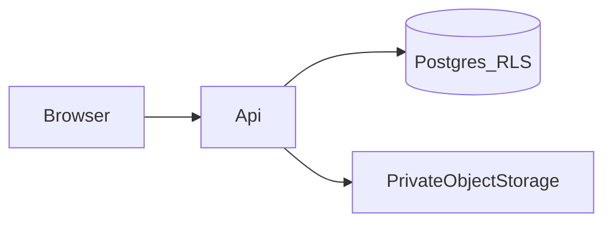

# Threat model

Phase 1 acceptance criteria. No control in this document has been built or tested. A passing test is a later phase's evidence, not a statement in this file.

## Assets

| Asset | Why it matters |
| --- | --- |
| Identity documents and generated KYC packages | Passports, visas, Emirates IDs, licences, bank details |
| Answers, ownership tables, PEP responses | Customer due-diligence content |
| Signature images and signature evidence | Authorisation of the declaration and the policy acknowledgement |
| Session cookies and invitation tokens | Account access |
| Template PDFs | The legal wording. A swapped template changes what the customer signed |
| Audit log | The record of who saw or decided what |
| Backups | A second copy of the assets above |

## Actors

- Customer user, invited into one tenant.
- Tenant maker, checker, authorised approver, and other employees.
- Platform super-admin.
- Background worker.
- Someone outside the system, including a user of another tenant.

AI assistance is not an actor that can approve. It may propose a document class or a completeness gap. A human records the compliance decision.

## Trust boundaries

The browser is untrusted. Hidden buttons and client-side tenant filters are not controls. The API is the enforcement point. The database RLS policy is a second enforcement point for tenant-owned rows. Object storage is private. The application issues a download only after the permission check. A storage URL is not a public link.

## Threats and required behaviour

| Id | Threat | Required behaviour |
| --- | --- | --- |
| T1 | Horizontal access. User in tenant A uses an id from tenant B. | API returns not found or forbidden. The response does not reveal that the other tenant's row exists. |
| T2 | Tenant id manipulation. Caller sends a different `tenantId` in the body, query, or header. | The server uses the tenant on the authenticated session. The supplied id is ignored or rejected when it disagrees. |
| T3 | Direct object download. Caller guesses a storage key. | The storage bucket is private. The API checks tenant, permission, and purpose before streaming bytes. |
| T4 | Invitation replay. A used or revoked token is submitted again. | The server rejects it. Expired tokens are rejected. |
| T5 | Expired or stolen session. | Privileged routes require a live session. MFA is required for privileged roles before those routes succeed. |
| T6 | Self-approval or overlapping maker and checker. | The approval service rejects the action when the segregation rule forbids that assignment. |
| T7 | Approval conflict. Two approvers act on different document versions. | The decision stores the document version. A stale version does not approve the newer one. |
| T8 | Worker leak. A job for tenant A reads tenant B. | The job sets the tenant context. A test calls the worker without a context and expects failure. |
| T9 | Admin curiosity. A super-admin opens a passport with no case purpose. | The permission for identity files is separate from platform administration. The read writes an audit event that includes the purpose. |
| T10 | Log leakage. Passwords, raw tokens, or document bytes are written to logs. | Logs store ids and outcomes. They do not store those secrets or file bodies. |
| T11 | Malicious upload. | Type check, size limit, and malware scan run before the file is available to reviewers. PDF parsing uses a safe path and does not execute document actions. |
| T12 | Template swap. | Generated output records the template hash. A mismatch with the registry fails the build. |
| T13 | Retention bypass. | A legal hold blocks irreversible deletion. A delete without the deletion approval is rejected. |

## Security acceptance tests

These are the tests Phase 2 and later must implement. They are not results.

- Cross-tenant read and write through the API, including search, export, and admin list endpoints.
- Cross-tenant file download and a forged storage key.
- A background job that is given tenant A's id and tenant B's record id.
- Invitation reuse, use after revocation, and use after expiry.
- A session used after logout or after expiry.
- Maker approving their own submission, and a checker who is also the maker.
- Two approval requests for different document versions of the same case.
- A log capture during login, invitation create, and file download, asserted free of passwords, raw tokens, and document bytes.

Transport encryption, encryption at rest, secrets management, monitoring, and encrypted backups are deployment requirements. They are not claimed here, because no environment has been chosen.

## Out of scope for the threat model

- Choosing a cloud region or naming a provider as compliant.
- Treating an image of a signature as a qualified electronic signature.
- Letting a model mark a customer approved.
